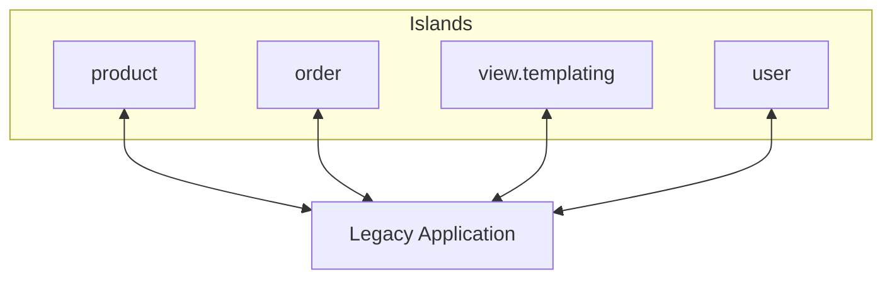
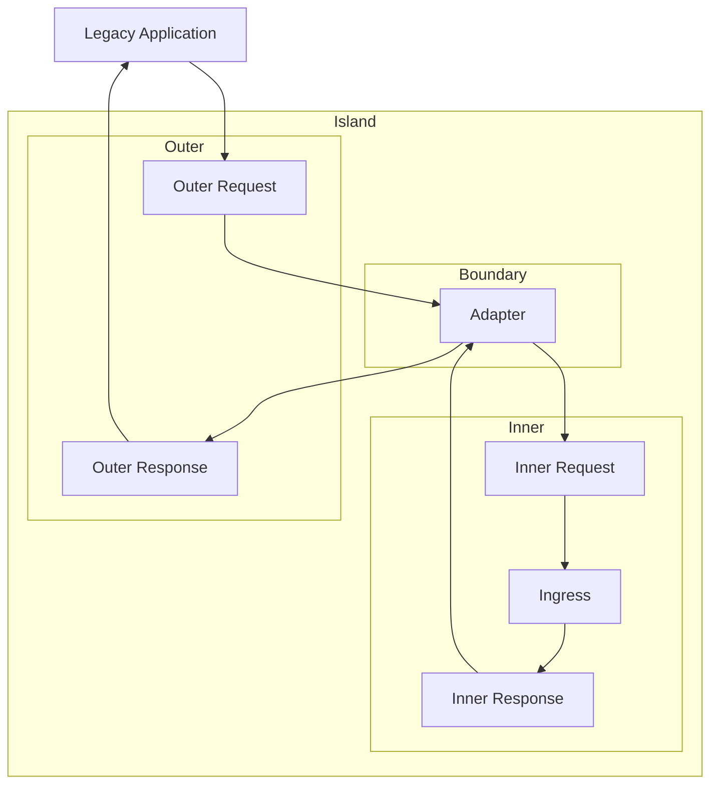

# Archipelago

**A legacy PHP refactoring framework compatible with PHP 5.0.0 through to current PHP versions.**

> [!WARNING]
> **Work in Progress:** This package is currently in active development ahead of its initial `1.0.0` release. The API is subject to change without notice, and it is **not recommended for production use** yet.

Archipelago is a small framework that helps developers incrementally refactor legacy/spaghetti PHP applications.

It provides a structured approach to extracting functionality from an existing application, moving it into isolated self-contained areas called **Islands**, and progressively replacing those Islands as the original logic of the application is rediscovered. All without requiring an application rewrite.



## The process

Let's say you have a legacy e-commerce application. It's currently spaghetti code and badly needs to be untangled.

Once Archipelago is installed, you would start by identifying areas of your codebase that could be extracted into Islands. An Island need not be large at this point, 2 or 3 lines of extracted code would do. If you see the same code repeated in several places in the spaghetti, that would also be a good candidate. You don't need to have a plan yet, in fact you shouldn't. But you do need to remember the golden rule: **no Island may ever send messages to another Island**.

Let's say that after some time, you ended up with the following Islands:

| Island                   | Responsibility                   |
|--------------------------|----------------------------------|
| `price_formatter`        | Formats prices for display.      |
| `currency_converter`     | Converts between currencies.     |
| `product_lookup`         | Retrieves product information.   |
| `stock_checker`          | Checks product availability.     |
| `customer_lookup`        | Retrieves customer information.  |
| `email_validator`        | Validates email addresses.       |
| `address_validator`      | Validates postal addresses.      |
| `cart_calculator`        | Calculates shopping cart totals. |
| `discount_calculator`    | Calculates applicable discounts. |
| `tax_calculator`         | Calculates tax.                  |
| `shipping_calculator`    | Calculates shipping costs.       |
| `order_number_generator` | Generates unique order numbers.  |

Since no Island may ever send messages to another Island, you likely would have found that a lot of the Islands you created were using the legacy application to send messages to one another. That's okay. What that is telling you is that those inter-related concerns are likely part of larger domains. You're starting to rediscover the initial application logic lost in the spaghetti.

The next step is to start thinking about replacing some of those smaller Islands with larger Islands. Let's say that you were able to create the following replacements:

| Island                  | Replaces                                                                           | Responsibility                              |
|-------------------------|------------------------------------------------------------------------------------|---------------------------------------------|
| `product`               | `product_lookup`, `stock_checker`                                                  | Product information and availability.       |
| `customer`              | `customer_lookup`, `email_validator`                                               | Customer records and contact details.       |
| `checkout`              | `cart_calculator`, `discount_calculator`, `tax_calculator`, `shipping_calculator`  | Cart totals, discounts, taxes and shipping. |
| `order`                 | `order_number_generator`                                                           | Order creation and identification.          |

That gives you this:

| Island                  | Responsibility                              |
|-------------------------|---------------------------------------------|
| `product`               | Product information and availability.       |
| `customer`              | Customer records and contact details.       |
| `checkout`              | Cart totals, discounts, taxes and shipping. |
| `order`                 | Order creation and identification.          |
| `price_formatter`       | Formats prices for display.                 |
| `currency_converter`    | Converts between currencies.                |
| `address_validator`     | Validates postal addresses.                 |

At this point you keep going, and whenever the friction between 2 or more Islands becomes inconvenient, you think about how you might replace them with a larger Island handling the same responsibilities. If you keep going long enough you will get this:

| Island                  | Responsibility                              |
|-------------------------|---------------------------------------------|
| `application`           | Handles all application responsibilities.   |

At this point, you've done it! All that remains to do now is to remove Archipelago. Congratulations!

The first changes you made were very low-risk and easily reversible. Every change you made shrunk the legacy codebase slightly. You never needed to plan in advance, and instead you let the logic buried in the spaghetti code reveal itself to you over time. Most importantly, **you never needed to build a replacement application**.

## Island Architecture

An Island is composed of three logical areas: Inner, Outer, and Boundary. Each has a distinct responsibility and a set of restrictions governing its dependencies.



### Inner

The Inner contains the actual logic extracted from the legacy application.

It must not reference classes or contain objects defined outside the Inner.

#### `Archipelago_Island_Inner_Request` and `Archipelago_Island_Inner_Response`

```php
interface Archipelago_Island_Inner_Request {}
interface Archipelago_Island_Inner_Response {}
```

These are empty interfaces for the messages that enter and leave the Inner.

#### `Archipelago_Island_Inner_Ingress`

```php
interface Archipelago_Island_Inner_Ingress
{
    /**
     * @return Archipelago_Island_Inner_Response
     */
    public function invoke(Archipelago_Island_Inner_Request $request);
}
```

This is the single entry point into the Inner. `invoke()` receives an Inner request and must return an Inner response.

### Outer

The Outer provides the integration point between the Island and the surrounding application.

It must not reference classes or contain objects defined inside the Inner, or defined in other Islands.

#### `Archipelago_Island_Outer_Request` and `Archipelago_Island_Outer_Response`

```php
interface Archipelago_Island_Outer_Request {}
interface Archipelago_Island_Outer_Response {}
```

These are empty interfaces for the messages that enter and leave the Outer.

### Boundary

The Boundary connects the Inner and the Outer.

It may not reference classes or contain objects defined inside other Islands, but otherwise has no restrictions.

#### `Archipelago_Island_Boundary_Adapter`

```php
interface Archipelago_Island_Boundary_Adapter
{
    /**
     * @return Archipelago_Island_Inner_Request
     */
    public function requestIn(Archipelago_Island_Outer_Request $request);

    /**
     * @return Archipelago_Island_Outer_Response
     */
    public function responseOut(Archipelago_Island_Inner_Response $response);
}
```

This translates between the application's world and the Island's world, on every run.

- **`requestIn()`** converts an Outer request, which may hold application objects, into an Inner request built only from Inner classes.
- **`responseOut()`** converts the Inner response back into an Outer response the application understands.

This is the only class that knows about both sides. Because the Inner never sees an application class, it can be tested and reasoned about in isolation, and the application's objects can change without touching the Inner.

This is an optional component. If it is not used, then requests to the Island must implement both `Archipelago_Island_Inner_Request` and `Archipelago_Island_Outer_Request`, and responses from the Ingress must implement both `Archipelago_Island_Inner_Response` and `Archipelago_Island_Outer_Response`. This means that neither can reference any classes defined anywhere, and must use simple data types only such as strings, integers, arrays etc. This allows for a simpler way to implement smaller Islands while keeping that guarantee that each side of the boundary remains isolated from the other.

#### `Archipelago_Island_Boundary_Configurator`

```php
interface Archipelago_Island_Boundary_Configurator
{
    /**
     * @return void
     */
    public function configure(Archipelago_Island_Inner_Ingress $ingress);
}
```

This is called once, the first time the island is run before the request is passed into the ingress. The Island Ingress is passed into it and any configuration/dependencies that the island may have can be injected via setters.

This is an optional component. If it is not used then the ingress will not be configured.

#### `Archipelago_Island_Boundary_Bootstrapper`

```php
interface Archipelago_Island_Boundary_Bootstrapper
{
    /**
     * @return void
     */
    public function onFirstRun();

    /**
     * @return void
     */
    public function onRegister();
}
```

This prepares the environment the Island runs in, typically loading classes or registering an autoloader.

- **`onRegister()`** runs once, when the Island is registered. Use it for the minimum the application needs straight away, such as loading the Outer request classes the application would need to run a registered Island.
- **`onFirstRun()`** runs once, the first time the Island is run, before the Configurator. Use it for everything else, so an Island that is registered but never used costs almost nothing.

This is an optional component. If it is not used then no bootstrapping happens.

## Installation

Archipelago can be installed in one of two ways:

### Using Composer

Install Archipelago through Composer:

```bash
composer require james-draper/archipelago
```

### Manual Installation

Alternatively, copy the `archipelago` directory into your project in a location accessible to your application.

Then include the bootstrap file:

```php
require '/path/to/archipelago/bootstrap.php';
```
